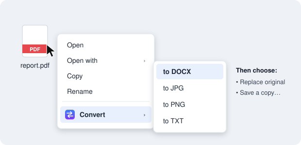
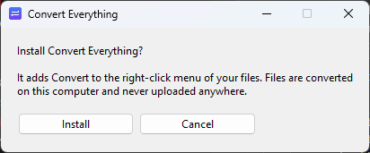
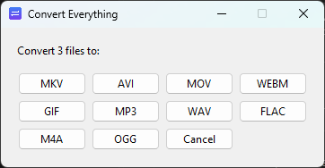
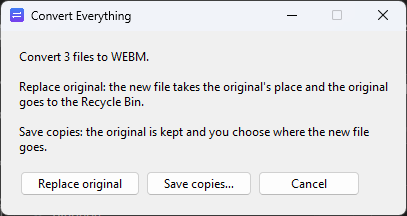
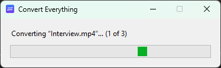

<p align="center">
  
</p>

<h1 align="center">Convert Everything</h1>

<p align="center">
  <b>Right-click any file → Convert → pick a format. Done.</b><br>
  No more uploading your files to "free online converter" websites.
</p>

<p align="center">
  <a href="https://github.com/emreasln/Convert_Everything/releases/latest"></a>
  
  <a href="LICENSE"></a>
</p>

<p align="center">
  
</p>

Convert Everything adds a **Convert** entry to your file manager's right-click menu and converts
files **locally, on your own computer**. Your files never leave your machine.

- 📄 **Documents:** PDF → Word, Word → PDF, Excel → CSV, PowerPoint → PDF, …
- 🖼️ **Images:** PNG, JPG, WEBP, GIF, BMP, TIFF, ICO, and images → PDF
- 🎬 **Video & audio:** MP4, MKV, MOV, WEBM, GIF, MP3, WAV, FLAC, …
- 📚 **Batch conversion:** select many files, right-click once, convert them all
- ♻️ **Replace or copy:** swap the file for the converted one (the original goes to the Recycle
  Bin / Trash, so nothing is lost), or save a copy anywhere you like
- 🖥️ **Stays in place:** replace a file on your Windows desktop and the new one appears right where
  the old icon was
- 🪶 **One-click install, clean uninstall.** Nothing else to install, no admin rights needed

## Download

| Windows 10 / 11 | macOS (Apple Silicon) | Linux (x64) |
|:---:|:---:|:---:|
| [**ConvertEverything-Windows-Setup.exe**](https://github.com/emreasln/Convert_Everything/releases/latest/download/ConvertEverything-Windows-Setup.exe) | [**ConvertEverything-macOS.zip**](https://github.com/emreasln/Convert_Everything/releases/latest/download/ConvertEverything-macOS.zip) | [**ConvertEverything-Linux.tar.gz**](https://github.com/emreasln/Convert_Everything/releases/latest/download/ConvertEverything-Linux.tar.gz) |

## Install

Open the file you downloaded and click **Install**. That's it.

<p align="center"></p>

<details>
<summary><b>Windows:</b> "Windows protected your PC"?</summary>

Convert Everything is free and not code-signed (a signing certificate costs money every year), so
Windows SmartScreen warns about it the first time. Click **More info → Run anyway**.
</details>

<details>
<summary><b>macOS:</b> "Apple could not verify ConvertEverything"?</summary>

Unzip the download (Safari does this for you) and open **ConvertEverything.app**. Because the app is
not notarized by Apple, macOS blocks it the first time:

1. Click **Done** in the warning.
2. Open **System Settings → Privacy & Security**, scroll down and click **Open Anyway** next to
   *ConvertEverything*.
3. Open the app again and click **Install**.
</details>

<details>
<summary><b>Linux:</b> how do I start it?</summary>

Extract the archive and double-click **ConvertEverything** inside the extracted folder. If your file
manager opens it as a file instead, right-click it and choose **Run as a Program**, or run
`./ConvertEverything` in a terminal from that folder.
</details>

After installing you can delete the download; the app has copied itself into your user profile.

## How to use it

1. Right-click a file, or a whole selection of files, and choose **Convert**.
   - **Windows 11:** click **Show more options** first (or hold **Shift** while right-clicking).
   - **macOS:** it's under **Quick Actions → Convert…**
   - **Linux:** GNOME Files: **Scripts → Convert** · Dolphin and Nemo: **Convert…**
2. Pick the format you want. On Windows the formats are right in the menu; on macOS and Linux a
   small window asks:

   

3. Choose what happens to the original:

   

   - **Replace original:** the new file takes the original's place and the original goes to the
     Recycle Bin / Trash.
   - **Save a copy…:** the original stays untouched and you choose where the new file goes.

4. Wait a moment. Big videos take a little longer:

   

## Uninstall

| | How |
|---|---|
| **Windows** | **Settings → Apps → Installed apps → Convert Everything → Uninstall** |
| **macOS / Linux** | Open the app you downloaded again and click **Uninstall** |

Uninstalling removes the menu entries and the app folder. Your converted files are, of course, kept.

## Supported conversions

| From | To |
|---|---|
| PNG, JPG/JPEG, BMP, GIF, TIFF, WEBP, ICO | PDF, PNG, JPG, BMP, GIF, TIFF, WEBP, ICO |
| PDF | DOCX, TXT, PNG, JPG |
| DOCX, DOC, ODT, RTF, TXT ¹ | PDF, DOCX, DOC, ODT, RTF, TXT |
| XLSX, XLS, ODS, CSV ¹ | PDF, XLSX, XLS, ODS, CSV |
| PPTX, PPT, ODP ¹ | PDF, PPTX, PPT, ODP |
| MP4, MKV, AVI, MOV, WEBM, WMV, FLV, M4V | MP4, MKV, AVI, MOV, WEBM, GIF, MP3, WAV, FLAC, M4A, OGG |
| MP3, WAV, FLAC, M4A, OGG, AAC, OPUS, WMA | MP3, WAV, FLAC, M4A, OGG |

¹ Office documents are converted with **Microsoft Office** (Windows, used automatically when
installed) or the free **[LibreOffice](https://www.libreoffice.org/download/)**. If neither is
installed, Convert Everything tells you how to get LibreOffice. Everything else works out of the box.

A PDF with several pages converted to an image gives one image per page (`name-1.png`,
`name-2.png`, …).

## Privacy

- Every conversion runs **offline, on your computer**. Nothing is uploaded anywhere.
- No telemetry, no accounts, no ads, no network access at all.

## What gets installed where

Everything lives in your own user profile. No admin rights, no system files touched.

| OS | App | Menu entry |
|---|---|---|
| Windows | `%LOCALAPPDATA%\ConvertEverything` | `HKCU\Software\Classes\SystemFileAssociations\.<ext>\shell\ConvertEverything`, plus an entry in *Installed apps* |
| macOS | `~/Library/Application Support/ConvertEverything` | `~/Library/Services/Convert Everything.workflow` |
| Linux | `~/.local/share/convert-everything` | `~/.local/share/nautilus/scripts/Convert`, `~/.local/share/kio/servicemenus/convert-everything.desktop`, `~/.local/share/nemo/actions/convert-everything.nemo_action` |

## FAQ

**Is "Replace original" safe?**
Yes. The original is moved to the Recycle Bin / Trash, not deleted, so you can always restore it.

**Why does the Windows 11 menu need "Show more options"?**
Windows 11 only lets apps with a paid, signed app package into its new compact menu. Everything
else lives under *Show more options*. Holding **Shift** while right-clicking opens that menu
directly.

**PDF → Word doesn't look exactly like the original.**
PDF files don't store paragraphs and layout the way Word does, so the result is a best-effort
reconstruction. It works best for text-based PDFs. Scanned PDFs are just pictures and contain no text.

**Why is the download fairly big?**
It contains everything needed to convert offline, including FFmpeg for video and audio and the PDF
engines, so you don't have to install anything else.

**My antivirus complains.**
Unsigned apps built with PyInstaller are sometimes flagged by mistake. The full source is in this
repository, and every release is built from it by GitHub Actions
([workflow](.github/workflows/release.yml)), so you can check exactly what you're running.

**I have an Intel Mac / another Linux architecture.**
Run it from source (see below).

## Run from source

Requires Python 3.9+ with tkinter.

```sh
pip install -r requirements.txt
python convert_everything/main.py            # opens the install window (menu entries point to this checkout)
python convert_everything/main.py FILE...    # convert files directly
```

Build the standalone app for your OS with `pip install pyinstaller && python packaging/build.py`.
The build converts a few test files with the packaged app before it produces anything.

```
convert_everything/
  converters.py   format table + conversion engines (Pillow, PyMuPDF, pdf2docx, Office/LibreOffice, FFmpeg)
  main.py         the windows you see: install, format picker, replace-or-copy, progress
  installer.py    installs/removes the app and the right-click menu entries for each OS
  desktop.py      Windows: keeps a replaced file's icon in the same spot on the desktop
packaging/build.py              builds the release for the current OS
.github/workflows/release.yml   builds Windows, macOS and Linux releases when a version tag is pushed
```

Adding a format is usually a one-line change to the `TABLE` in `converters.py`.
Issues and pull requests are welcome.

## License

[MIT](LICENSE)
